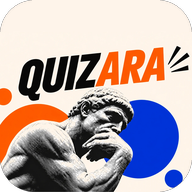

# Quizara (ΚΟΥΙΖΑΡΑ)



A Greek trivia party game for Android. Two teams compete on one phone, usually with a host reading
the questions aloud. It works fully offline: no account, no ads, no permissions.

## Features

### Game modes
- **⚔ Σπέσιαλ (formerly Μονομαχία)**: teams take turns on a board of 18 questions, one per category at ×1
  (easy), ×2 (medium) and ×3 (hard) points. Every game deals a fresh random board from the
  question bank, and a saved game keeps its board. Optional **Special** rounds (each can be played
  twice):

  | Special | How it plays | Points |
  |---|---|---|
  | 🏆 TOP 5 | Name the 5 answers in a list | 5/5 = 3, stopped at 4/5 = 2 |
  | ◎ ΒΡΕΣ 3 | Name any 3 of the accepted answers | 2 |
  | 👤 PERSON ID | Guess the person from up to 3 clues | 3 / 2 / 1 by clue |
  | 🌐 COUNTRY ID | Guess the country from up to 3 clues | 3 / 2 / 1 by clue |
  | ↕ ΒΑΛ' ΤΑ ΣΕ ΣΕΙΡΑ | Drag the items into the right order | 2 |
  | ⌁ ΒΡΕΣ ΤΗ ΣΥΝΔΕΣΗ | Say what connects a list of items | 2 |

- **🧠 Κλασικό (Classic)**: get 2 correct answers in each of the six categories (12 in total),
  choosing between two categories every round. A right answer keeps your turn. Each team has one
  **Κλοπή** (steal a missed question), one **Ανακάτεμα** (reshuffle the category choice) and one
  **Αλλαγή ερώτησης** (swap the question).

- **🧀 4 Τυριά (Four Cheeses)**: teams alternate after every question; two correct answers in a
  category win that category's cheese, and the first team to four cheeses wins. Each team has one
  **Σαμποτάζ**, which knocks a step off an opponent's progress, and the trailing team gets a
  **Τελευταία Ευκαιρία** (last chance) to sabotage before a win. At 3–3 it goes to Sudden Death.

- **🔪 Sudden Death**: breaks ties with a roulette of quick challenges: true/false, multiple choice,
  over/under, A/B, or closest number.

### Six categories
⚽ Sports · 🎨 Art · ⚛ Science · 🏛 History · 🧠 General knowledge · 🌐 Geography

### Questions included
| Set | Questions |
|---|---|
| Classic / 4 Τυριά | 5,933 |
| Σπέσιαλ board | 5,933 |
| Σπέσιαλ Specials | 2,994 |
| Sudden Death | 1,116 |

### Also
- **Διπλασιασμός (×2)**: in Σπέσιαλ each team can double the value of one question per game.
- **Μαθηματικό τέλος**: a game ends early once the trailing team can no longer catch up.
- Team names and colours, an optional question timer (30 / 45 / 60 s), light and dark themes, and
  automatic save and resume.
- Σπέσιαλ result screens show the correct answer and wait for **ΣΥΝΕΧΕΙΑ**, so everyone can read it.
- ⓘ buttons explain each one-use action (Διπλασιασμός, Ανακάτεμα, Σαμποτάζ) where you use it.

Runs on **Android 6.0 or newer**. The interface and the questions are in Greek.

## Download the app

Every push to `main` (and every pull request) builds an APK on GitHub.

1. Open the [Actions tab](https://github.com/gkonstantos/QUIZARA-APP/actions/workflows/build-apk.yml)
   and click the latest green run.
2. Under **Artifacts**, download **quizara-debug** (you must be signed in to GitHub) and unzip it.
3. Copy `app-debug.apk` to your phone and open it. Android will ask you to allow installing apps
   from that source.

This build installs as **Quizara** (`com.monomaxia.gnoseon.preview`), separately from the older
ΚΟΥΙΖΑΡΑ app. If Android refuses to update an existing Quizara install, uninstall it first: builds
signed with different keys can't update each other.

## Run the project

### Requirements
- [Android Studio](https://developer.android.com/studio) (recent), or **JDK 17** plus the Android
  SDK for command-line builds.
- No other installs: the Gradle wrapper downloads Gradle 8.13, and the Android Gradle plugin
  downloads Android SDK platform 36 on the first build.

### Get the code
```bash
git clone https://github.com/gkonstantos/QUIZARA-APP.git
```

### With Android Studio
1. **File → Open** and select the `QUIZARA-APP` folder.
2. Wait for the Gradle sync to finish.
3. Connect a phone with USB debugging enabled (or start an emulator) and press **Run ▶**.

### From the command line
Set `ANDROID_HOME` to your Android SDK folder (on Windows usually
`%LOCALAPPDATA%\Android\Sdk`), then:

```bash
./gradlew :app:assembleDebug        # Windows: gradlew.bat :app:assembleDebug
adb install -r app/build/outputs/apk/debug/app-debug.apk
```

`build-preview.sh` is an alternative build that calls the SDK tools directly, without Gradle.

### Signing
Debug builds are signed with `development/preview.keystore` when that file is present, so they
update an existing Quizara preview install. The file is deliberately **not** in git; without it,
builds use the standard Android debug key. Neither key may be used for a Play Store release.

## Editing the questions

The four files in `app/src/main/assets/` are generated from three reviewed Excel workbooks. Each
workbook is the complete set for its modes, so regenerating replaces the questions in the app:

```bash
pip install openpyxl
python tools/import_question_workbooks.py   --classic  "OLES OI KLASIKES KATHGORIES.xlsm"   --sudden   "QUIZARA_Xafnikos_Thanatos_Extra_Skalotika_Mandela.xlsx"   --specials "QUIZARA_SPECIAL_6_KATIGORIES_POP_GOSSIP_EMPLOUTISMENO.xlsx"
```

Then rebuild. The workbooks need these sheets:

- **Classic** (also fills the Σπέσιαλ board): *Γεωγραφία, Ιστορία, Τέχνη, Αθλητικά, Γενικές,
  Επιστήμη* with the columns *ID* (or *Κλειδί*), *Ερώτηση, Απάντηση, Δυσκολία*.
- **Sudden Death**: *ΣΩΣΤΟ_ΛΑΘΟΣ, ΠΟΛΛΑΠΛΗΣ, ΠΑΝΩ_ΚΑΤΩ, ΔΙΑΛΕΞΕ, ΠΙΟ_ΚΟΝΤΑ* with *ID, Ερώτηση,
  Επιλογή Α–Δ, Σωστή απάντηση, Αριθμητική απάντηση, Μονάδα, Αιτιολόγηση*.
- **Specials**: *Top 5, Βρες 3, Βάλτα σε σειρά, Βρες τη σύνδεση, Person ID, Country ID*. Rows listed in
  *ΑΔΙΚΑ_ΔΥΣΚΟΛΕΣ_ΕΛΕΓΧΟΣ* and TOP 5 rows marked "Μετακινήθηκε στο τέλος" are left out of the game.

Repeated questions are dropped (same text and answer, or nearly the same text with the same
answer). The script prints what it dropped and stops with an error if a mode would be left without
the questions it needs.

### Questions suggested by players

**＋ Πρότεινε** on the home screen lets players write a question of any kind: Κλασική, Top 5,
Βρες 3, Βάλ' τα σε σειρά, Βρες τη σύνδεση, Person ID or Country ID. The fields change with the
kind (for example five answers for Top 5, three clues for Person ID). The app opens a Google
Form with their text already filled in, and they submit it there; the app itself sends nothing and
has no internet permission. The form's answers collect in a Google Sheet. To approve a suggestion,
write `ναι` in its *Εγκρίθηκε* column (fix the wording there if needed), download the sheet as
.xlsx and add it when regenerating:

```bash
python tools/import_question_workbooks.py ... --suggestions "Quizara προτάσεις.xlsx"
```

Approved classic rows join the classic questions and the other kinds join the Specials; ones that
repeat an existing question, or miss a field their kind needs, are dropped. The
form's address and field numbers are set in `SuggestionForm.java` (see the comment there); with
none set, the screen shows that suggestions are not available yet.

#### Daily import

A GitHub Actions job (`.github/workflows/import-suggestions.yml`) does this every day at 02:47 UTC (04:47 in Greece, 05:47 in summer),
so approving a row in the sheet is enough. It downloads the sheet and runs the importer with
`--update`, which keeps the questions already in the app and replaces only the suggested ones
(ids `suggestion_N`, N = the sheet row) with the approved rows. So an edited row is updated and a
row whose `ναι` is removed goes away again. If anything changed, the job raises the version
(0.13.0 → 0.13.1), builds the APK, commits to `main` and publishes the APK as a GitHub release.
Days with nothing new produce nothing. It can also be started by hand from the Actions tab
(*Import approved suggestions* → *Run workflow*).

Setup, once (repository *Settings → Secrets and variables → Actions → New repository secret*):

- `SUGGESTIONS_SHEET_ID`: the part of the response sheet's address between `/d/` and `/edit`. Share
  the sheet as *anyone with the link can view*.
- `PREVIEW_KEYSTORE_B64`: `development/preview.keystore` in base64, so the APK installs over
  existing copies. In PowerShell, from the project folder:
  `[Convert]::ToBase64String([IO.File]::ReadAllBytes("$PWD\development\preview.keystore")) | Set-Clipboard`

Don't sort or delete rows in the response sheet: the row number is the question's id. Pull before
working locally, since the job commits version bumps to `main`.

## Project layout

```
app/src/main/java/.../MainActivity.java   the game (plain Java, no libraries)
app/src/main/java/.../CheeseGame.java     4 Τυριά rules, independent of Android
app/src/main/java/.../QuizaraIcons.java   drawn icons for the Special and Sudden Death modes
app/src/main/java/.../SuggestionForm.java  Google Form link for suggested questions
app/src/main/assets/                       question banks (JSON)
app/src/main/res/                          posters, logos, sounds, launcher icons, theme
tools/import_question_workbooks.py         Excel workbooks → question JSON
build-preview.sh                           Gradle-free build script
tools/bump_version.py                      raises versionCode/versionName (used by the daily job)
.github/workflows/build-apk.yml            CI build that produces the APK
.github/workflows/import-suggestions.yml   daily import of approved suggestions + release
```

## Version

**0.13.0** (version code 51): suggestions can be of any kind (the six Special kinds as well as
classic), and approved ones are imported into the matching bank. On the suggestion screen the title
and the kind buttons stay in place; only the fields below them change and scroll.

**0.12.9** (version code 50): players can suggest questions (**＋ Πρότεινε** on the home screen),
sent through a Google Form; approved suggestions are added with `--suggestions`.

**0.12.8** (version code 49): question banks rebuilt from the reviewed workbooks: 5,933 classic
questions (from 3,449), 2,994 Specials (from 720) and 1,116 Sudden Death questions (from 250), with
corrected questions replacing the old ones and repeats removed.

**0.12.7** (version code 48): launcher icon redrawn from the new home poster (circles instead of
triangles); the round icon is now actually round, and the drawn-in grey frame is gone.

**0.12.6** (version code 47): ported from the colleague's 0.12.5 build: drawn line icons instead of
emoji for the Specials and Sudden Death modes, new circle-style posters, a stable 2-column Special
board, a Sudden Death transition that shows the drawn mode, filled cheese wedges in 4 Τυριά, centred
scores, and a red "closest number" round. Their ΒΑΛ' ΤΑ ΣΕ ΣΕΙΡΑ tap-to-continue screen was not
ported: every Special result screen here already shows the correct order and waits for ΣΥΝΕΧΕΙΑ.
The version code is above their 0.12.5.1 (46) so this build can update theirs.

**0.11.10** (version code 34): 4 Τυριά turns alternate after every question, "Last Dance" is now
**Τελευταία Ευκαιρία** with an explanatory popup, and the turn banner shows only the team name.

**0.11.9** (version code 33): the 0.11.8 redesign (poster home screen, 4 Τυριά, ΒΡΕΣ ΤΗ ΣΥΝΔΕΣΗ,
team colours, new icon) and its follow-up polish (Μονομαχία renamed Σπέσιαλ, TOP 5 worth 3/2,
coloured answer buttons, ⓘ help on actions, new category icons) merged with:
- result screens that wait for **ΣΥΝΕΧΕΙΑ** and always show the answer;
- sounds that no longer freeze the screen when cards flip, and a smoother roulette;
- a fix for a crash on Android 6;
- default team names **Ομάδα 1** / **Ομάδα 2**;
- early finish that accounts for TOP 5's new 3 points;
- the Excel converter, Gradle wrapper and CI build.
