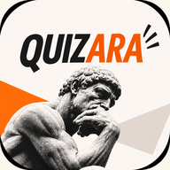

# Quizara (ΚΟΥΙΖΑΡΑ)



A Greek trivia party game for Android. Two teams compete on one phone, usually with a host reading
the questions aloud. It works fully offline: no account, no ads, no permissions.

## Features

### Game modes
- **⚔ Σπέσιαλ (formerly Μονομαχία)**: teams take turns on a board of 18 questions, one per category at ×1
  (easy), ×2 (medium) and ×3 (hard) points. Every game deals a fresh random board from the
  question bank, and a saved game keeps its board. Optional **Special** rounds (each can be played
  twice):

  | Special | How it plays | Points |
  |---|---|---|
  | 🏆 TOP 5 | Name the 5 answers in a list | 5/5 = 3, stopped at 4/5 = 2 |
  | ◎ ΒΡΕΣ 3 | Name any 3 of the accepted answers | 2 |
  | 👤 PERSON ID | Guess the person from up to 3 clues | 3 / 2 / 1 by clue |
  | 🌐 COUNTRY ID | Guess the country from up to 3 clues | 3 / 2 / 1 by clue |
  | ↕ ΒΑΛ' ΤΑ ΣΕ ΣΕΙΡΑ | Drag the items into the right order | 2 |
  | ⌁ ΒΡΕΣ ΤΗ ΣΥΝΔΕΣΗ | Say what connects a list of items | 2 |

- **🧠 Κλασικό (Classic)**: get 2 correct answers in each of the six categories (12 in total),
  choosing between two categories every round. A right answer keeps your turn. Each team has one
  **Κλοπή** (steal a missed question), one **Ανακάτεμα** (reshuffle the category choice) and one
  **Αλλαγή ερώτησης** (swap the question).

- **🧀 4 Τυριά (Four Cheeses)**: teams alternate after every question; two correct answers in a
  category win that category's cheese, and the first team to four cheeses wins. Each team has one
  **Σαμποτάζ**, which knocks a step off an opponent's progress, and the trailing team gets a
  **Τελευταία Ευκαιρία** (last chance) to sabotage before a win. At 3–3 it goes to Sudden Death.

- **🔪 Sudden Death**: breaks ties with a roulette of quick challenges: true/false, multiple choice,
  over/under, A/B, or closest number.

### Six categories
⚽ Sports · 🎨 Art · ⚛ Science · 🏛 History · 🧠 General knowledge · 🌐 Geography

### Questions included
| Set | Questions |
|---|---|
| Classic / 4 Τυριά | 3,449 |
| Σπέσιαλ board | 3,449 |
| Σπέσιαλ Specials | 720 |
| Sudden Death | 250 |

### Also
- **Διπλασιασμός (×2)**: in Σπέσιαλ each team can double the value of one question per game.
- **Μαθηματικό τέλος**: a game ends early once the trailing team can no longer catch up.
- Team names and colours, an optional question timer (30 / 45 / 60 s), light and dark themes, and
  automatic save and resume.
- Σπέσιαλ result screens show the correct answer and wait for **ΣΥΝΕΧΕΙΑ**, so everyone can read it.
- ⓘ buttons explain each one-use action (Διπλασιασμός, Ανακάτεμα, Σαμποτάζ) where you use it.

Runs on **Android 6.0 or newer**. The interface and the questions are in Greek.

## Download the app

Every push to `main` (and every pull request) builds an APK on GitHub.

1. Open the [Actions tab](https://github.com/gkonstantos/QUIZARA-APP/actions/workflows/build-apk.yml)
   and click the latest green run.
2. Under **Artifacts**, download **quizara-debug** (you must be signed in to GitHub) and unzip it.
3. Copy `app-debug.apk` to your phone and open it. Android will ask you to allow installing apps
   from that source.

This build installs as **Quizara** (`com.monomaxia.gnoseon.preview`), separately from the older
ΚΟΥΙΖΑΡΑ app. If Android refuses to update an existing Quizara install, uninstall it first: builds
signed with different keys can't update each other.

## Run the project

### Requirements
- [Android Studio](https://developer.android.com/studio) (recent), or **JDK 17** plus the Android
  SDK for command-line builds.
- No other installs: the Gradle wrapper downloads Gradle 8.13, and the Android Gradle plugin
  downloads Android SDK platform 36 on the first build.

### Get the code
```bash
git clone https://github.com/gkonstantos/QUIZARA-APP.git
```

### With Android Studio
1. **File → Open** and select the `QUIZARA-APP` folder.
2. Wait for the Gradle sync to finish.
3. Connect a phone with USB debugging enabled (or start an emulator) and press **Run ▶**.

### From the command line
Set `ANDROID_HOME` to your Android SDK folder (on Windows usually
`%LOCALAPPDATA%\Android\Sdk`), then:

```bash
./gradlew :app:assembleDebug        # Windows: gradlew.bat :app:assembleDebug
adb install -r app/build/outputs/apk/debug/app-debug.apk
```

`build-preview.sh` is an alternative build that calls the SDK tools directly, without Gradle.

### Signing
Debug builds are signed with `development/preview.keystore` when that file is present, so they
update an existing Quizara preview install. The file is deliberately **not** in git; without it,
builds use the standard Android debug key. Neither key may be used for a Play Store release.

## Editing the questions

The four files in `app/src/main/assets/` are generated from Excel sheets. To change the questions,
edit the sheets and regenerate:

```bash
pip install openpyxl
python tools/excel_to_json.py "path/to/the/excel/folder"
```

Then rebuild. Each file's role comes from its name: `SPORTS`, `ARTS`, `SCIENCE`, `HISTORY`,
`GENERAL`, `GEOGRAPHY` for the categories; `TOP5`, `FIND3`, `PERSON_ID`, `COUNTRY_ID`, `RANK`,
`CONNECTION` for the Specials; and `TF_`, `MC_`, `OU_`, `AB_`, `CLOSEST_sudden_death` for Sudden
Death. A `CONNECTION` sheet has the columns *Κλειδί, Στοιχεία, Σύνδεση, Επεξήγηση*; without one,
the connection questions already in the app are kept. The script stops with an error if a mode
would be left without the questions it needs.

## Project layout

```
app/src/main/java/.../MainActivity.java   the game (plain Java, no libraries)
app/src/main/java/.../CheeseGame.java     4 Τυριά rules, independent of Android
app/src/main/assets/                       question banks (JSON)
app/src/main/res/                          posters, logos, sounds, launcher icons, theme
tools/excel_to_json.py                     Excel → JSON converter
build-preview.sh                           Gradle-free build script
.github/workflows/build-apk.yml            CI build that produces the APK
```

## Version

**0.11.10** (version code 34): 4 Τυριά turns alternate after every question, "Last Dance" is now
**Τελευταία Ευκαιρία** with an explanatory popup, and the turn banner shows only the team name.

**0.11.9** (version code 33): the 0.11.8 redesign (poster home screen, 4 Τυριά, ΒΡΕΣ ΤΗ ΣΥΝΔΕΣΗ,
team colours, new icon) and its follow-up polish (Μονομαχία renamed Σπέσιαλ, TOP 5 worth 3/2,
coloured answer buttons, ⓘ help on actions, new category icons) merged with:
- result screens that wait for **ΣΥΝΕΧΕΙΑ** and always show the answer;
- sounds that no longer freeze the screen when cards flip, and a smoother roulette;
- a fix for a crash on Android 6;
- default team names **Ομάδα 1** / **Ομάδα 2**;
- early finish that accounts for TOP 5's new 3 points;
- the Excel converter, Gradle wrapper and CI build.
